# using Spring AMQP

## Topic Exchange



## pom.xml

```xml

<dependencies>
    <dependency>
        <groupId>org.springframework.boot</groupId>
        <artifactId>spring-boot-starter-amqp</artifactId>
    </dependency>
</dependencies>
```

## application.properties

```text
spring.rabbitmq.host=192.168.103.135
spring.rabbitmq.port=5672
spring.rabbitmq.username=test
spring.rabbitmq.password=123456
```

## producer

```
@RestController
@RequestMapping("/rabbitmq/api/v1")
public class RabbitMQController {

    @Autowired
    private RabbitTemplate rabbitTemplate;

    @GetMapping("/hello")
    public String hello() {
        rabbitTemplate.convertAndSend("topic.exchange", "order.create", "订单创建消息");
        rabbitTemplate.convertAndSend("topic.exchange", "order.update", "订单更新消息");
        return "hello";
    }
}
```

## consumer

```
@Component
public class Consumer {

    @RabbitListener(bindings = @QueueBinding(
            value = @Queue(name = "topic.queue", durable = "true"),
            exchange = @Exchange(name = "topic.exchange", type = ExchangeTypes.TOPIC),
            key = "order.*"
    ))
    public void handleTopicMessage(String message) {
        System.out.println("Received Topic Message: " + message);
    }
}
```